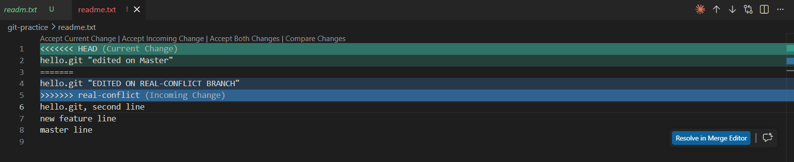

# Topic 6 — Git Fundamentals: Commits, Branches, Merges

> Personal study notebook — full teaching content, commands, outputs, and explanations.
> Distinct from `progress.md` (tracking) and `session_notes.md` (short personal reflection).

---

## Day 1 — 2026-07-16 (heavy scaffolding: commits, branches, fast-forward merge)

Practiced from Windows PowerShell directly (`C:\CloudOps\git-practice`), not WSL — Git behaves
identically either way; this environment was chosen since VS Code (native Windows install, not
WSL) is the tool used for GitHub work going forward.

### 1. The save-file analogy

- **Commit** = a save point — a snapshot of the whole project at one moment, with a message
  describing what changed
- **Repository (repo)** = the whole save-file folder, containing every save point ever made
- **Branch** = a separate save-file slot — try something risky in one slot while the main slot
  stays untouched, decide later whether to bring it back in
- **Merge** = combining two branches' progress into one

Unlike a simple "undo," Git tracks *who* changed *what*, *when*, and *why*.

### 2. The three-stage model

1. **Working directory** — actual files on disk right now
2. **Staging area** ("the index") — a holding area where you pick exactly which changes go into
   the *next* commit
3. **Repository (committed history)** — permanent snapshots, once committed

Analogy: packing a box to mail (stage) before actually sealing and shipping it (commit) — you
choose what goes in the box, and can add/remove things before sealing it, but once shipped, that
snapshot is permanent.

**Why a separate staging area matters, worked through with a concrete example**: if two unrelated
files are both changed in the working directory, but only one should go into the next commit as
its own clean, logically separate change — `git add` just that one file, leaving the other
genuinely untouched and uncommitted. Staging is what makes clean, single-purpose commits possible
instead of one commit mixing unrelated changes.

### 3. Setup and identity check

**Syntax**: `git config --global user.name` / `user.email` — show configured commit identity
(every commit is permanently stamped with this).

**Verified hands-on** — already configured, no setup needed:
```
PS> git --version
git version 2.54.0.windows.1
PS> git config --global user.name
Saranya Sallagundla
PS> git config --global user.email
user@example.com
```

### 4. `git init` — starting a repository

**Syntax**: `git init` — turns the current folder into a Git repository (creates a hidden `.git`
folder storing all history).

**Verified hands-on**:
```
PS C:\CloudOps\git-practice> git init
Initialized empty Git repository in C:/CloudOps/git-practice/.git/
PS> ls -Force
d--h-  ...  .git
```

### 5. `git status`, `git add`, `git commit` — the basic workflow

**Syntax**: `git status` — shows current state of working directory/staging area
**Syntax**: `git add FILE` — stage a file
**Syntax**: `git commit -m "MESSAGE"` — create a permanent snapshot of everything staged

**Verified hands-on — full first commit cycle**:
```
PS> "hello.git" > readme.txt
PS> git status
Untracked files:
        readme.txt

PS> git add readme.txt
warning: in the working copy of 'readme.txt', CRLF will be replaced by LF the next time Git touches it
PS> git status
Changes to be committed:
        new file:   readme.txt

PS> git commit -m "Add readme file"
[master (root-commit) 9925f29] Add readme file
 1 file changed, 1 insertion(+)
```
- **"Untracked"** → Git sees the file exists but isn't tracking it at all yet.
- **CRLF warning** — a real, common cross-platform Git quirk: Windows text files traditionally
  end lines with `CRLF` (carriage-return + line-feed); Linux/Mac use just `LF`. Git normalizes to
  `LF` internally to keep the repository consistent regardless of which OS commits to it.
  Informational only, not an error.
- **`(root-commit)`** — flags this as the very first commit in the repo's history (no parent).
- **`9925f29`** — the commit hash, a unique ID generated from the content itself.

### 6. `git log` and `HEAD`

**Syntax**: `git log` — shows commit history, most recent first.

**Verified hands-on — second commit, growing history**:
```
PS> "hello.git, second line" >> readme.txt
PS> git add readme.txt
PS> git commit -m "Add 2nd line to readme"
[master b2a0446] Add 2nd line to readme

PS> git log
commit b2a04469245e2eb042bd3d8d7bb50b63f6106ffc (HEAD -> master)
...
commit 9925f299c623efb1722e7b77d075dd1542d31b9b
...
```
**`HEAD`** — a special pointer marking "where you currently are." Right now it points at
`master`, which itself points at the latest commit. As new commits happen, `HEAD` and the branch
both move forward together. Becomes central once branches are involved — `HEAD` is what actually
moves when switching branches, not the commits themselves.

### 7. Branches

**Syntax**: `git branch` — list branches (current one marked with `*`)
**Syntax**: `git branch NAME` — create a branch without switching
**Syntax**: `git checkout NAME` (or `git switch NAME`) — switch to a branch
**Syntax**: `git checkout -b NAME` — create AND switch in one step

**Verified hands-on**:
```
PS> git branch
* master
PS> git checkout -b feature-branch
Switched to a new branch 'feature-branch'
PS> git branch
* feature-branch
  master
```

**Proven hands-on — branches are genuinely isolated**:
```
PS> "New feature line" >> readme.txt
PS> git add readme.txt
PS> git commit -m "Add feature line"
[feature-branch 714ab7c] Add feature line

PS> git checkout master
Switched to branch 'master'
PS> cat readme.txt
hello.git
hello.git, second line
```
The "new feature line" is **absent** on `master` even though it was just committed on
`feature-branch` moments earlier — real proof of isolated, separate history per branch.

### 8. Merging — fast-forward

**Syntax**: `git merge BRANCH_NAME` — while standing on the target branch, pull in another
branch's changes.

**Verified hands-on**:
```
PS> git merge feature-branch
Updating b2a0446..714ab7c
Fast-forward
 readme.txt | 1 +
PS> cat readme.txt
hello.git
hello.git, second line
new feature line
```
**Confirmed via `git log`**: both `master` and `feature-branch` ended up pointing at the *same*
commit (`(HEAD -> master, feature-branch)` on one line) — the literal definition of a
fast-forward: `master` had zero new commits since the branch point, so Git simply moved its
pointer forward to match, no real "combining" needed.

---

## Day 2 — 2026-07-16 (harder: real merge conflicts, `.gitignore`, `git diff`, combined scenario)

### 1. Why the first "conflict" attempt wasn't actually a conflict

**First attempt** (didn't produce a conflict, and this was a useful real lesson): created
`conflict-branch` from a commit, edited line 1 there, merged back into `master` with **no new
commits made on `master` in between** → another fast-forward, not a conflict. **Root lesson**:
a genuine conflict requires **both** branches to change **after diverging**, specifically editing
the **same line** differently — simply branching and editing on one side is not enough.

### 2. Setting up and resolving a real conflict

**Correct setup**: made a new commit on `master` first, *then* branched off (`real-conflict`),
edited line 1 differently on each side, so both branches diverged from the same starting point
with conflicting edits to the identical line.

**Verified hands-on — the conflict occurring**:
```
PS> git checkout -b real-conflict
... edited line 1 to "hello.git - EDITED ON REAL-CONFLICT BRANCH" via VS Code ...
PS> git commit -m "Edit line 1 on real-conflict branch"

PS> git checkout master
... edited line 1 to "hello.git - EDITED ON MASTER" via VS Code ...
PS> git commit -m "Edit line 1 on master"

PS> git merge real-conflict
Auto-merging readme.txt
CONFLICT (content): Merge conflict in readme.txt
Automatic merge failed; fix conflicts and then commit the result.
```

**The actual conflict markers, seen directly in the file** (shown here with a leading `|` on each
marker line so this notebook itself doesn't get mistaken for an unresolved conflict by an
editor's merge-conflict detector — a real gotcha hit once already while writing these notes):
```
| <<<<<<< HEAD
hello.git "edited on Master"
| =======
hello.git "EDITED ON REAL-CONFLICT BRANCH"
| >>>>>>> real-conflict
hello.git, second line
new feature line
master line
```
- **`<<<<<<< HEAD`** (start-of-conflict marker) — opens with the **current branch's** version
  (`master`, since `HEAD` points there).
- Content between the `<<<<<<< HEAD` line and the `=======` line — master's version of the line.
- **`=======`** (divider marker) — separates the two conflicting versions.
- Content between the `=======` line and the `>>>>>>> real-conflict` line — the **incoming**
  branch's version.
- **`>>>>>>> real-conflict`** (end-of-conflict marker) — closes with the incoming branch's label.

**What this actually looked like in VS Code** (static screenshot — safe to view, nothing
clickable/functional in this image, unlike the live version above):



**Resolution — via VS Code's built-in merge conflict UI** (not manual marker-deleting), which
shows clickable inline links above the conflict block:
- **Accept Current Change** — keep `HEAD`'s version, discard incoming
- **Accept Incoming Change** — keep the incoming version, discard current
- **Accept Both Changes** — keep both, one after another
- **Compare Changes** — side-by-side diff view

Chose **Accept Current Change** (kept master's version) — a real, common resolution choice: one
side is simply judged correct and the other dropped.

**Verified hands-on — after resolving**:
```
PS> git add readme.txt
PS> git commit -m "Resolve merge conflict on line 1, keep master version"
[master 0d41a29] Resolve merge conflict on line 1, keep master version

PS> cat readme.txt
hello.git "edited on Master"
hello.git, second line
new feature line
master line
```
Confirmed clean — no marker lines remain, only the chosen version of line 1.

### 3. `.gitignore`

Some files should never be tracked — temp files, secrets, build artifacts. `.gitignore` is a
plain-text file listing patterns Git should ignore.

**Verified hands-on**:
```
PS> "*.log" > .gitignore
PS> "secret.txt" >> .gitignore
PS> git add .gitignore
PS> git commit -m "Add gitignore"
[master 2a5302c] add gitignore
```

### 4. `git diff`

**Syntax**: `git diff` — shows exact line-by-line changes in the working directory that aren't
staged yet.

**Verified hands-on**:
```
PS> "one more line" >> readme.txt
PS> git diff
diff --git a/readme.txt b/readme.txt
index 3345eaa..afbf2f9 100644
--- a/readme.txt
+++ b/readme.txt
@@ -2,3 +2,4 @@ hello.git "edited on Master"
 hello.git, second line
 new feature line
 master line
+one more line
```
**Decoding the output**:
- `-` lines = removed, `+` lines = added (`+one more line` here — pure addition, nothing removed)
- **Hunk header** `@@ -OLD_START,OLD_COUNT +NEW_START,NEW_COUNT @@` — here `@@ -2,3 +2,4 @@`
  means: old version starts at line 2, shows 3 lines; new version starts at line 2, shows 4
  lines. Same starting point, one more line in the new version — matches the single addition made.

### 5. Combined scenario — shared-file merge outcomes

**Scenario**: working on a feature branch for two days while a teammate merges changes into
`master` touching the same file. What happens on merging back, and what are the two possible
outcomes?

**Answered correctly**: if the **same lines** were changed on both sides → real conflict,
requiring manual resolution (exactly what was just practiced). If **different lines/files**
changed → Git auto-merges cleanly (matches both fast-forward merges done earlier, and the
resolved conflict which only collided on one specific line).

**Follow-up — why use branches over direct commits to a shared `master` at all?**: without
branches, two developers committing directly to the same shared branch risk one silently
overwriting the other's changes with no warning at all. Branches keep each developer's work
isolated during active development, and any conflict only surfaces **at merge time**
(integration), rather than silently clobbering shared history the moment either person commits.

---

## Topic 6 Quiz — both days combined — Attempt 1: PASS, 84/100

Interview-style, open-ended, 5 questions covering both days.

1. **Three-stage model, and why a separate staging area matters** — correct on the core purpose
   immediately; needed one follow-up for a concrete example (selectively staging one of two
   changed files for a clean, separate commit).
2. **What `HEAD` is, and what happens to it on `git checkout`** — passed cleanly, first try.
3. **Why a merge showed "Fast-forward" instead of a real merge** — passed cleanly, first try,
   correctly named the exact condition (master unchanged since the branch point).
4. **Conflict marker lines — order and meaning** — first answer imprecise (wrong order/labels);
   corrected cleanly once asked to check against the actual real output from earlier in the
   session, correctly identifying `<<<<<<< HEAD` as first/current and the `=======`-to-`>>>>>>>`
   section as incoming.
5. **Direct commits to shared `master` vs. branches — the real problem and the fix** — correctly
   named the silent-overwrite risk unprompted; needed one nudge to complete the second half
   (branches isolate work and surface conflicts only at merge time).

**Score: 84/100** (Quiz 30/40 — correct throughout, 2 of 5 needed a real follow-up correction, not
just a light nudge; Hands-on 28/30 — genuinely excellent, full real workflow including **two**
fast-forward merges — one where the "conflict" setup didn't actually conflict, correctly
understood and re-set-up properly — plus an actual resolved merge conflict via VS Code's UI,
`.gitignore`, and `git diff`; Depth 26/30 — strong scenario reasoning, and the trial-and-error in
properly setting up a genuine conflict showed real engagement with *why* fast-forward happens,
not just memorized steps).

**Final verdict: Topic 6 CLEARED, attempt 1, 84/100.**
